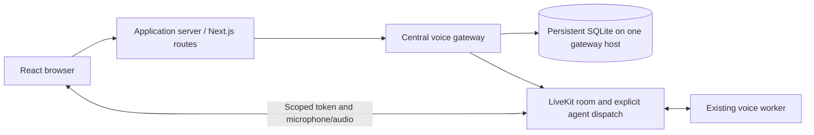

# Independent website integrations

These references connect a website to an explicitly dispatched LiveKit Cloud voice worker. They
do not import Python runtime code into a browser, add portfolio content, or deploy anything.
The core worker remains Deepgram → Groq → Cartesia. New greeting/ending features require a
separately approved worker update; connecting to an existing worker preserves its current behavior.

## Setup and ownership

1. Keep your worker deployment/credentials independent for each project. Confirm its explicit
   dispatch name and deployed max-session/idle/request limits. The reference defaults match the
   core's 1800-second maximum and 120-second idle timeout, but you must verify deployed overrides.
2. Configure the central Python gateway using gateway/.env.example as a **server-only template**.
   Inject variables through your service manager; this gateway does not search/load dotenv files.
   It needs LiveKit server credentials, an exact HTTPS web origin, its own strong assertion secret,
   and an absolute database path on a durable local volume. It needs no STT/LLM/TTS keys.
3. Run the gateway as a separate supervised service using the existing locked Python environment:
   `uv run python -m integrations.gateway.app`. This is an operational action, not part of offline
   tests. It binds 127.0.0.1:8080; put authenticated HTTPS/private networking in front of it.
4. Copy react/ into your React app and nextjs/app/api/voice plus nextjs/server into your Next.js
   App Router project, preserving relative imports. Merge the TypeScript extension-import setting
   from tsconfig.json, or adapt import paths to the host build. Configure nextjs/.env.example values
   **only on the application server**, never NEXT_PUBLIC_. Mount `<VoiceSession />` where needed.
5. Implement nextjs/server/auth.ts with your actual server-verified session/challenge and trusted
   network identity. It deliberately fails closed until configured. Do not trust body IDs, plain
   cookies, localStorage or arbitrary X-Forwarded-For. Anonymous public sites require an appropriate
   verified anti-abuse challenge/session policy plus the global/network budget; the reference does
   not invent an authentication provider or claim that anonymous identity defeats Sybil attacks.

The private npm package here is for example verification, not publication or a complete Next.js
app. Run `npm ci --ignore-scripts`, `npm run typecheck` and `npm test` inside integrations/. Python
gateway requirements are already installed transitively by the unchanged worker uv.lock; the
separate requirements.txt names its direct dependencies for independent hosting. Use a reviewed
lock/constraints for any separate production environment.

## Framework-neutral contract

Your browser calls its **own application server**, sending only an empty JSON object:

| Method/path | Success | Purpose |
| --- | --- | --- |
| POST /api/voice/sessions | 201: sessionId, serverUrl, token, expiresAt, deadline | Admit one voice session |
| POST /api/voice/sessions/{sessionId}/end | 200 ended=true; 202 ended=false | Explicit end; 202 means cleanup is pending |

The app server verifies identity and origin/body limits, signs a server-to-server HS256 assertion
(issuer voice-web, audience voice-gateway, sub/network, iat/nbf/exp, lifetime at most 60 seconds),
and forwards an empty JSON body to the gateway's corresponding /v1/sessions endpoint. Use a
dedicated >=32-byte secret shared only by those two services. Subject/network values must derive
from trusted server context. The gateway hashes them before persistent storage. Other backend
frameworks can implement this same proxy contract; they need no voice-worker imports or frontend
LiveKit API secrets. Copying the Next.js authentication placeholder alone grants no access.

Responses are no-store. The proxy bounds and validates input, whitelists successful response
fields and normalizes errors. There is no browser-selectable room, identity, agent name, model,
duration or token-refresh endpoint. No token/provider/exception payload is logged by the examples.

The gateway generates random room/participant identities, creates one room and explicitly
dispatches the configured agent once. Its official SDK token is short-lived, room-scoped,
microphone-only for publication and audio-subscription capable, without admin/create/record/data
or agent-management grants. Browser tokens do not embed dispatch, so replay cannot itself launch
another worker. Standard LiveKit JWTs contain an issuer key identifier; no API secret or ability
to mint privileged tokens is sent to the browser. Provider keys remain with the worker.

The React controller keeps tokens in memory, handles starting/connecting/connected/reconnecting/
ending/error states, toggles the microphone and attaches remote audio. Disconnect, agent departure,
unmount and late async results are cleaned up. Reconnection does not request another session token.
Audio autoplay/device permission can require user action. Browser end/unmount is best effort;
the persistent backend deadline is authoritative. UI/local disconnect is not proof of remote
cleanup: 202/failure is labelled pending rather than successful teardown.

## Persistent limits and production topology

This implementation uses a **single central gateway host**, with every worker/process sharing the
same SQLite file on a persistent local filesystem. WAL, FULL synchronous writes and BEGIN IMMEDIATE
transactions serialize admission. A process restart or another connection does not reset budgets.
No in-memory fallback exists. Do not use ephemeral/serverless storage, separate SQLite files per
replica, or a network filesystem. Frontend/proxy instances may scale independently, but horizontal
gateway hosts require a real shared transactional store adapter, not independent copies of this DB.
Do not deploy this SQLite gateway as a Vercel serverless function. A Next.js proxy hosted on
Vercel may call the separately hosted durable gateway; it must not create a local quota database.
Upstash integration is deferred to the future portfolio implementation. This handoff includes no
Upstash adapter; replacing SQLite with a shared store requires its own atomic-quota and cleanup
verification before any serverless gateway production use.

Configure AdmissionLimits through VOICE_GATEWAY_<FIELD_NAME> environment variables. Limits cover
global, authenticated-principal and trusted-network concurrent reservations, fixed UTC-minute
requests, daily session counts and daily reserved seconds. End requests also have persisted rate
limits. Full verified **worker_hard_seconds** is reserved upfront per admission, not just the
shorter requested gateway deadline. Early ending or failed provisioning does not refund the day
budget. Changing tokens, tabs or subject/network IDs cannot bypass the global cap. This is a
conservative usage budget, not measured usage or a currency guarantee; use account-level spending
controls and verified identity/abuse protection as well.

The gateway reaper checks every five seconds. Actual enforced end includes that interval/API
latency; upstream outages cannot guarantee exact-time disconnection. The deployed worker hard
duration and idle limits remain backstops, so verify them before public traffic. No browser
heartbeat extends a reservation. Unknown create/dispatch outcomes are not retried. Cleanup
revokes the participant token with an explicit cutoff and deletes the room; capacity is freed
only after acknowledgements. Cleanup attempts are persisted, at most six, one minute apart.
Exhaustion retains the slot until operator reconciliation, rather than admitting unlimited work.
Monitor fixed gateway_request_unavailable/gateway_reaper_unavailable/gateway_cleanup_pending codes
and overdue nonclosed database rows. Do not automatically delete failed leases or reset counters.

This gateway deliberately requires secure *.livekit.cloud endpoints: strict token revocation is
a Cloud feature. It uses explicit RemoveParticipant.revoke_token_ts because the default revocation
buffer permits some refreshed-token rejoins. Keep service clocks synchronized. It is not a
certified public-site token gateway for self-hosted LiveKit/custom domains. The worker core itself
retains independent Docker/self-host support. Follow the current Cloud revocation contract before
changing this boundary. An authenticated request is not authorization for a different session:
end is restricted to the reservation's principal and closed sessions are idempotent.

Protect the durable directory with owner-only access, supervise the gateway/reaper, back up the
SQLite database safely and place request/connection controls at the trusted edge. Store failures
return unavailable and never fall back to process-local counters. Old closed usage metadata is
pruned conservatively; failed leases remain for reconciliation. Treat config/auth/clock/volume
review as mandatory before public traffic. Do not enable debug HTTP logging of tokens/headers.

## Verification boundaries and troubleshooting

Offline tests exercise actual local SQLite transactions, concurrent connections, a fresh
interpreter, real local HTTP and official JWT generation/verification. LiveKit control API calls,
browser rooms/audio and application authentication are scripted/injected. Type checking verifies
the pinned LiveKit client API; it does not establish a built Next.js app, microphone playback,
Cloud dispatch/revocation, production storage availability or real billing/latency.

- 401/403: check your server authentication adapter, assertion issuer/audience/clock, secret and
  exact origin. Never solve this by trusting browser subject/IP fields or disabling validation.
- 429: examine configured persisted budgets/concurrency; do not mint tokens elsewhere or clear
  the DB to bypass them. A previous unknown/failed cleanup may intentionally hold capacity.
- 503: the auth adapter may still be unconfigured, or storage/upstream may be unavailable. Logs
  contain fixed codes; do not dump secrets, assertions, upstream bodies or the full environment.
- No agent: verify the matching explicit dispatch name/project and authorized running worker.
  A connected room is not proof of provider readiness. No worker update is required just to
  connect; customization changes require a separate approved worker update.
- End pending: keep the reaper/service supervised and reconcile failed revocation/delete operations.
  Do not claim cleanup from UI state alone. No automatic rollback, deployment or cost-bearing test
  is authorized by these instructions.

Previous release blockers remain in [the release checklist](../docs/RELEASE.md): live metrics and
scenario coverage, image/operations/draining/rollback, licensing and voice rights. The old Phase 9
archive predates these changes and is not a release of this extension. No portfolio repository,
credentials, deployed worker or hosting account is modified by copying these examples.

Official references reviewed for the implementation:
[tools](https://docs.livekit.io/agents/logic/tools/definition/),
[speech handles](https://docs.livekit.io/agents/multimodality/audio/),
[tool reply suppression](https://docs.livekit.io/reference/agents/events/),
[tokens and revocation](https://docs.livekit.io/frontends/reference/tokens-grants/),
[room API](https://docs.livekit.io/reference/other/roomservice-api/),
[Next.js route handlers](https://nextjs.org/docs/app/api-reference/file-conventions/route).
